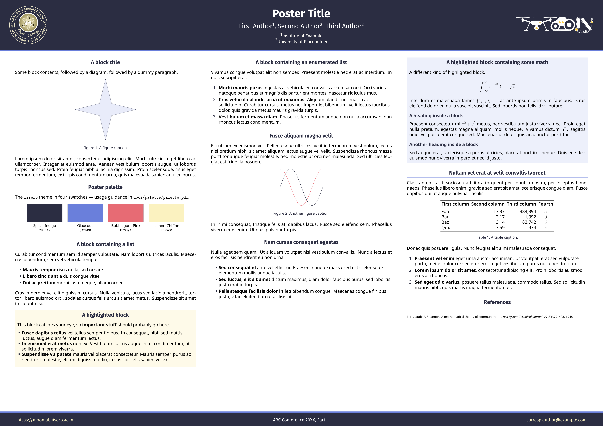
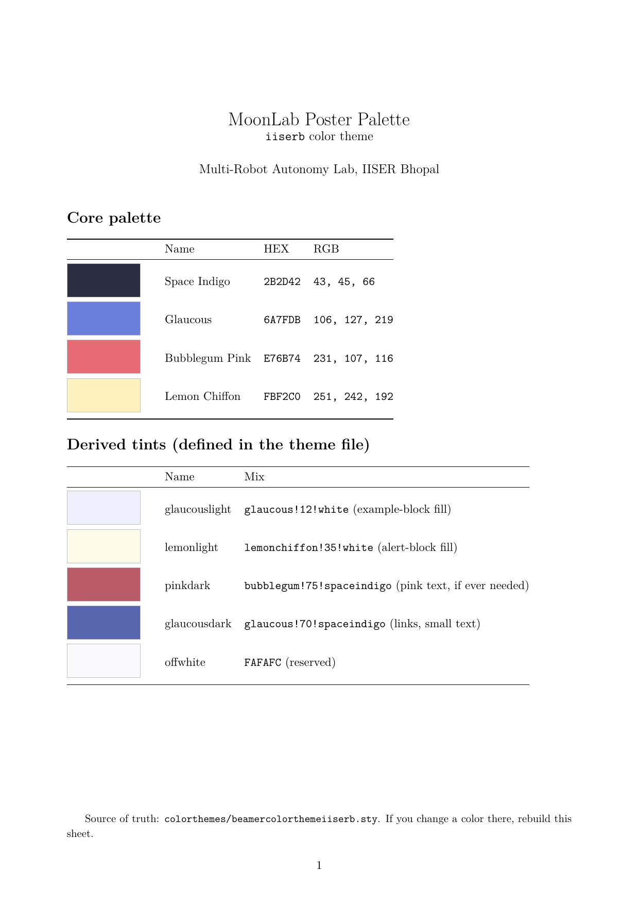

# MoonLab Poster Template

An academic poster template (A0 landscape) for the Multi-Robot Autonomy Lab,
IISER Bhopal. Built on the Gemini [beamerposter] theme with a custom `iiserb`
color theme, Fira Sans titles + Noto Sans body, and `authblk` author handling.

New here? Start with [GETTING_STARTED](docs/GETTING_STARTED.md) — it walks
through your first poster step by step.



## Layout: what to edit

| File | Purpose — edit this for… |
|---|---|
| `main.tex` | Orchestrator only: paper size, logo placement, footer. Rarely needs changes. |
| `meta/info.tex` | Title, conference line, website, contact email. |
| `meta/authors.tex` | Authors + affiliations via `authblk` (`\author[n]{…}` / `\affil[n]{…}`, any number of authors). |
| `sections/_index.tex` | All poster body content: blocks, figures, tables, references. |
| `references.bib` | Bibliography entries. |
| `colorthemes/beamercolorthemeiiserb.sty` | The color theme (source of truth for colors). |
| `beamerthemegemini.sty` | Fonts and headline/block layout. |
| `figures/logos/` | IISERB crest (left) and MoonLab wordmark (right). |

`main.tex` pulls it all together with `\input{meta/info.tex}`,
`\input{meta/authors.tex}`, and `\input{sections/_index.tex}`.

## Quick start

```bash
make main.pdf        # builds main.pdf (LuaLaTeX via latexmk, see .latexmkrc)
make clean           # removes build artifacts
```

Requirements for a native build: LuaLaTeX, `latexmk`, `bibtex`, and the
TeX Live packages `beamerposter`, `fontspec`, `authblk`, `pgfplots`
(Ubuntu: `texlive-latex-extra texlive-fonts-recommended texlive-fonts-extra
lmodern texlive-luatex texlive-xetex latexmk` — same list CI installs).
No TeX installed? Use the Docker devcontainer instead (below).

PDF builds land in the project root (`main.pdf`, git-ignored). If content
overflows the page you will see `Overfull \vbox (... too high)` in the log —
trim text in `sections/_index.tex` until it disappears.

## Color palette



Four colors, used sparingly: **Space Indigo** `#2B2D42` (headline, titles),
**Glaucous** `#6A7FDB` (rules, accents), **Bubblegum Pink** `#E76B74`
(alert separator only), **Lemon Chiffon** `#FBF2C0` (tints + footer links).
Full details and do/don't guidance:

- [docs/palette/palette.pdf](docs/palette/palette.pdf) — swatches (p. 1) + usage suggestions (p. 2)
- Source: [docs/palette/palette.tex](docs/palette/palette.tex) (rebuild after any theme color change)

## Docker devcontainer (VS Code)

No local TeX setup needed. Requires Docker, VS Code, and the Dev Containers
extension. See [GETTING_STARTED](docs/GETTING_STARTED.md#option-b-docker-devcontainer-recommended-if-you-have-no-tex-installation)
for the full walkthrough; the short version:

1. Open this folder in VS Code.
2. `Ctrl+Shift+P` → **Dev Containers: Reopen in Container** (first build downloads the TeX Live image layers, takes a while).
3. In the container terminal: `make main.pdf`.

Config lives in [.devcontainer/](.devcontainer/) (`Dockerfile` + `devcontainer.json`,
TeX Live packages mirrored from CI, LaTeX Workshop extension preinstalled).
The container is untested — if the build fails, please report what broke.

## Editor notes (neovim + VimTeX)

`.latexmkrc` already selects the LuaLaTeX engine (`$pdf_mode = 4`) and adds
`colorthemes/` to `TEXINPUTS`, so `:VimtexCompile` (single-shot or continuous)
works with no extra configuration. Interaction mode is left at the default:
VimTeX appends `-interaction=nonstopmode` itself (errors go to the quickfix
list), while terminal runs stay interactive (`?` prompt on error).

## Paper size, fonts, logos

- Size is set in `main.tex`: `width=118.9,height=84.1` = **A0 landscape**.
- Fonts: Fira Sans (titles, from TeX Live) + Noto Sans (body). To switch the
body font (e.g. back to Lato), see the commented block in `beamerthemegemini.sty`.
- Logos: `\logoleft` (IISERB, `height=7.5cm`) and `\logoright` (MoonLab white
variant for the dark bar, `height=3.2cm`) in `main.tex`. The heights differ
deliberately — a square crest and a wide wordmark need different heights to
look balanced.

## Troubleshooting

| Symptom | Fix |
|---|---|
| `File 'beamercolortheme….sty' not found` | Build via `make`/`latexmk` so `.latexmkrc` adds `colorthemes/` to `TEXINPUTS`; plain `lualatex` needs `TEXINPUTS='./colorthemes//:'` in the environment. |
| `fontspec` / font errors, or pdfLaTeX ran | Must compile with LuaLaTeX (`make`/`latexmk` already do). |
| `Overfull \vbox` | Content taller than the page — cut text/figures in `sections/_index.tex`. |
| Authors/affiliations look wrong | Check `\author[n]` / `\affil[n]` numbering in `meta/authors.tex`. |
| Poster looks like a circus ad | Re-read [palette p. 2](docs/palette/palette.pdf); pink and lemon each get one job. |

## Credits & license

Poster machinery: Gemini theme by Anish Athalye ([beamerposter] upstream).
MoonLab customization (`iiserb` theme, fonts, layout): Multi-Robot Autonomy
Lab, IISER Bhopal. License: see [LICENSE.md](LICENSE.md).

[beamerposter]: https://github.com/deselaers/latex-beamerposter
